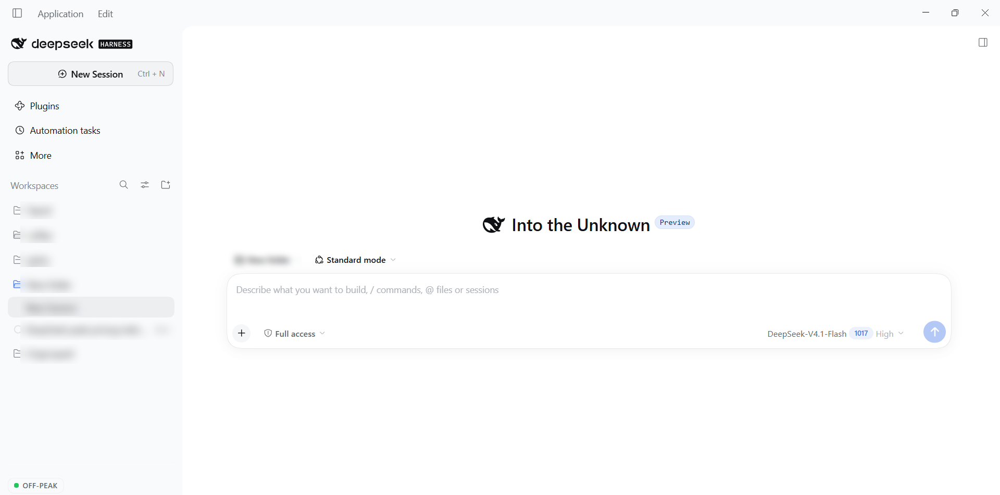
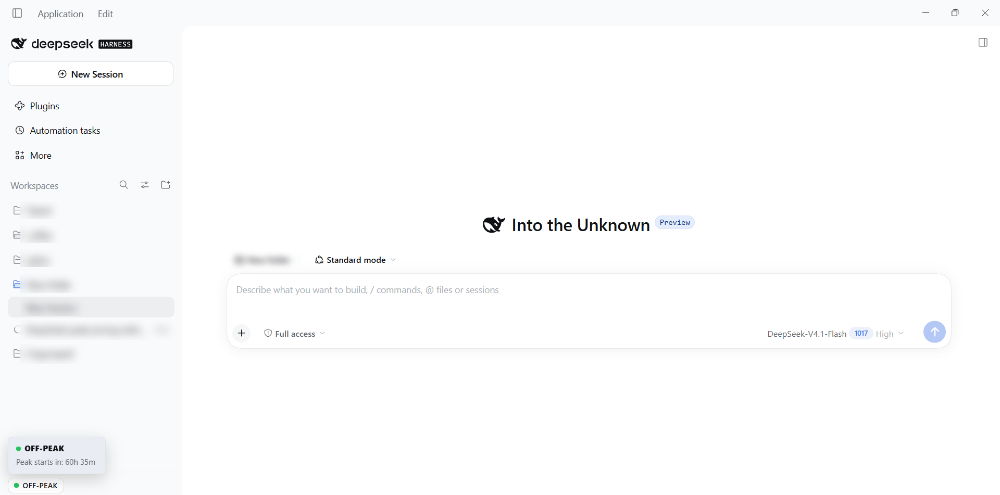
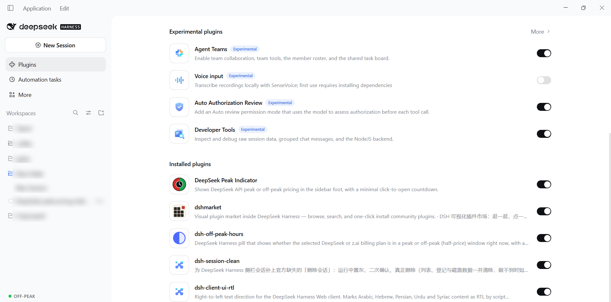

# نشانگر پیک DeepSeek

[English](README.md) · **فارسی** · [简体中文](README.zh-CN.md)


یک افزونه کوچک DeepSeek Harness که نشان می‌دهد آیا **دوره قیمت‌گذاری رسمی DeepSeek API** در حال حاضر پیک است یا خارج از پیک — درست در پاورقی نوار کناری سراسری، از زمان شروع برنامه، بدون نیاز به باز بودن Session یا Conversation.

> پیک به معنای آن است که قیمت رسمی API در نرخ بالاتر **پیک** قرار دارد. این وضعیت **هیچ** ادعایی درباره بار سرور یا ازدحام نیست؛ فقط دوره صورت‌حساب تعریف‌شده توسط DeepSeek را گزارش می‌کند.

- بسته افزونه: `@local/deepseek-peak-indicator` · نسخه `1.0.0`
- تأییدشده روی: **DeepSeek Harness Desktop v0.2.1-rc.5** (Windows)
- جایگاه رابط کاربری: **`sidebar.footer.action`** (با دامنه ریشه، پاورقی دائمی نوار کناری)
- بدون کلید API، بدون بک‌اند، بدون درخواست شبکه، بدون تله‌متری.

---

## فهرست مطالب

1. [مقدمه و هدف](#1-مقدمه-و-هدف)
2. [ویژگی های اصلی](#2-ویژگی-های-اصلی)
3. [جایگاه در رابط کاربری](#3-جایگاه-در-رابط-کاربری)
4. [حالت های PEAK و OFF-PEAK و UNKNOWN](#4-حالت-های-peak-و-off-peak-و-unknown)
5. [پنجره بازشو کمینه](#5-پنجره-بازشو-کمینه)
6. [زمان بندی رسمی قیمت گذاری DeepSeek](#6-زمان-بندی-رسمی-قیمت-گذاری-deepseek)
7. [استثناهای تعطیلات عمومی چین](#7-استثناهای-تعطیلات-عمومی-چین)
8. [منطقه زمانی Asia/Kabul](#8-منطقه-زمانی-asiakabul)
9. [معماری و چرخه عمر افزونه](#9-معماری-و-چرخه-عمر-افزونه)
10. [ساختار پروژه](#10-ساختار-پروژه)
11. [نصب](#11-نصب)
12. [بهروزرسانی و حذف نصب](#12-بهروزرسانی-و-حذف-نصب)
13. [آزمون ها](#13-آزمون-ها)
14. [محدودیت های شناخته شده](#14-محدودیت-های-شناخته-شده)
15. [حریم خصوصی و امنیت](#15-حریم-خصوصی-و-امنیت)
16. [تصاویر](#16-تصاویر)
17. [نویسنده و مخزن](#17-نویسنده-و-مخزن)
18. [مجوز](#18-مجوز)
19. [سپاسگزاری ها و منابع رسمی](#19-سپاسگزاری-ها-و-منابع-رسمی)

---

## 1. مقدمه و هدف

API DeepSeek بسته به زمان روز (و تعطیلات عمومی چین) دو قیمت دارد: **قیمت پیک** و **قیمت خارج از پیک با نصف نرخ**. قواعد در صفحه رسمی قیمت‌گذاری منتشر شده‌اند، اما شما باید آن‌ها را به خاطر بسپارید، به منطقه زمانی خودتان تبدیل کنید و ساعت را بررسی کنید.

**نشانگر پیک DeepSeek** دقیقاً همین کار را در یک نگاه انجام می‌دهد: یک نقطه رنگی کوچک و یک برچسب در پاورقی نوار کناری Harness. با کلیک روی آن، افزونه فقط چیزی را می‌گوید که لازم دارید — دوره فعلی و مدت باقی‌مانده آن:

- این یک **نشانگر دوره قیمت‌گذاری** است، نه پایشگر بار؛
- **پیش از باز شدن هر Session** کار می‌کند؛
- **از کلید API استفاده نمی‌کند و هیچ درخواست شبکه‌ای نمی‌فرستد**؛
- هرگز حدس نمی‌زند: اگر تقویم تعطیلات چین برای یک سال تأیید نشده باشد، نشانگر در تنها ساعت‌هایی که تقویم تعطیلات اهمیت دارد **UNKNOWN** نشان می‌دهد.

## 2. ویژگی های اصلی

- 🟢/🔴/⚪ **یک نگاه، سه وضعیت**: OFF-PEAK، PEAK، UNKNOWN.
- 📍 **جایگاه سراسری**: پاورقی دائمی نوار کناری، مستقل از Session، Conversation و Composer.
- 🖱️ **پنجره بازشو کمینه دو خطی**: وضعیت به همراه زمان باقی‌مانده در دوره فعلی.
- ⏱️ **دقیق**: وضعیت دقیقاً در مرز رسمی دوره تغییر می‌کند؛ شمارش معکوس هر دقیقه یک بار و فقط با ساعت و دقیقه تازه می‌شود (هرگز ثانیه).
- 🇨🇳 **تعطیلات عمومی رسمی چین**: 2025 و 2026 از اطلاعیه‌های شورای دولتی تأیید شده‌اند؛ سالی که تأیید نشده باشد، به جای «بدون تعطیلات»، UNKNOWN گزارش می‌شود.
- 🌐 **ایمن از نظر منطقه زمانی**: زمان‌بندی در UTC ارزیابی می‌شود، تاریخ تعطیلات در وقت استاندارد چین، و همه تبدیل‌ها از طریق پایگاه داده IANA `Intl` مرورگر انجام می‌شوند — بدون آفست‌های ثابت UTC و ایمن در برابر ساعت تابستانی (DST).
- 🪶 **کوچک و بدون وابستگی**: یک بسته Client، یک تایمر 60 ثانیه‌ای به‌علاوه یک تایمر گذار؛ بدون وابستگی زمان اجرای npm؛ بدون نمودار، داشبورد، تحلیل داده یا تغییر مدل.
- 🔒 **خصوصی از پایه**: بدون کلید API، بدون بک‌اند، بدون پایگاه داده، بدون polling، بدون تله‌متری.
- 🧹 **چرخه عمر تمیز**: هر تایمر، شنونده رویداد، ناظر و برگه استایل هنگام تخلیه حذف می‌شود؛ افزونه با دقیقاً یک ثبت، به‌درستی تخلیه و دوباره بارگذاری می‌شود.

## 3. جایگاه در رابط کاربری

نشانگر در **`sidebar.footer.action`** ثبت می‌شود — جایگاه فهرستی با دامنه ریشه که عنوان آن «کنش‌های اختیاری کنار Settings در پاورقی نوار کناری» است و بسته نوار کناری عرضه‌شده `@deepseek-ai/dsh-client-ui-sidebar` آن را تعریف می‌کند.

چرا این جایگاه:

- **با دامنه ریشه** است، بنابراین به Session، Conversation یا Composer وابسته نیست؛
- بخشی از **پوسته دائمی برنامه** است، بنابراین بلافاصله پس از شروع حاضر است؛
- یک **جایگاه فهرستی افزودنی** است (`replaceRisk: none`)، بنابراین بدون جایگزینی چیزی، کنار کنترل Settings عرضه‌شده می‌نشیند؛
- مالک یک پرچم `wide` ارسال می‌کند، بنابراین نشانگر می‌تواند در ریل 56 px یک فرم جمع‌وجور رندر کند.

افزونه همچنین `sidebar.brand.mark` (ناحیه برند) را بررسی و رد کرد: در v0.2.1-rc.5 آن جایگاه یک **جایگاه واحد و فقط قابل جایگزینی است که از قبل با نشان برند عرضه‌شده اشغال شده** (`replaceRisk: shadows-shipped-ui`). استفاده از آن به جای افزودن یک نشانگر وضعیت، برند محصول را تحت‌الشعاع قرار می‌داد و در چیدمان نوار عنوان Windows در ریل جمع‌شده رندر نمی‌شود.

نوار کناری بازشده یک دکمه قرصی جمع‌وجور — `● OFF-PEAK`، `● PEAK` یا `● UNKNOWN` — نمایش می‌دهد و ریل جمع‌شده (جایی که پوسته کنش پاورقی را با `wide: false` رندر می‌کند) یک دکمه 28 px که فقط یک نقطه دارد را نمایش می‌دهد و راهنمای شناور (tooltip) و نام دسترس‌پذیر آن وضعیت را حمل می‌کنند. برای رفتار نوار کناری جمع‌شده در Windows به [محدودیت های شناخته شده](#14-محدودیت-های-شناخته-شده) مراجعه کنید.

## 4. حالت های PEAK و OFF-PEAK و UNKNOWN

| وضعیت | معنا |
| --- | --- |
| 🔴 **PEAK** | لحظه فعلی درون یک بازه پیک رسمی DeepSeek در روز دوشنبه تا جمعه است و آن تاریخ در فهرست تعطیلات عمومی تأییدشده چین نیست. قیمت بالاتر API اعمال می‌شود. |
| 🟢 **OFF-PEAK** | هر حالت دیگر: بیرون از دو بازه پیک روزانه، در آخر هفته، یا در یکی از تعطیلات عمومی تأییدشده چین. قیمت API با نصف قیمت پیک اعمال می‌شود. |
| ⚪ **UNKNOWN** | لحظه فعلی درون یک بازه پیک روز هفته است، اما تقویم تعطیلات محلی برای آن سال **تأیید نشده** است (غایب، منتشرنشده یا بدشکل). افزونه بدون داده تأییدشده تعطیلات، از ادعای PEAK یا OFF-PEAK خودداری می‌کند. |

آخر هفته‌ها در تمام روز خارج از پیک می‌مانند، از جمله روزهای آخر هفته‌ای که شورای دولتی چین آن‌ها را روزهای کاری جبرانی (调休) اعلام می‌کند؛ این مطابق با عبارت DeepSeek است که آخر هفته‌ها و تعطیلات را «به طور کامل» خارج از پیک می‌داند. پنجره بازشو کمینه هرگز برای UNKNOWN شمارش معکوس نشان نمی‌دهد.

## 5. پنجره بازشو کمینه

روی نشانگر کلیک کنید؛ برای بستن، دوباره کلیک کنید، `Escape` را فشار دهید یا بیرون از آن کلیک کنید. پنجره بازشو دقیقاً **دو خط** دارد:

**PEAK**

```
🔴 PEAK
Off-Peak starts in: 2h 13m
```

**OFF-PEAK**

```
🟢 OFF-PEAK
Peak starts in: 61h 29m
```

**UNKNOWN**

```
⚪ UNKNOWN
Next transition cannot be reliably determined.
```

- شمارش معکوس، زمان باقی‌مانده تا پایان دوره فعلی است و فقط به ساعت و دقیقه کامل نمایش داده می‌شود (هرگز ثانیه).
- هر دقیقه یک بار تازه می‌شود؛ یک تایمر گذار دقیق، وضعیت را در مرز رسمی تغییر می‌دهد.
- اگر پایان دوره فعلی در سالی قرار بگیرد که تقویم تعطیلات آن تأیید نشده است، افزونه به جای ساختن شمارش معکوس، خط UNKNOWN را نشان می‌دهد.
- هیچ زمان فعلی، هیچ منطقه زمانی دیگری، هیچ توضیح قیمت‌گذاری، هیچ جدول زمان‌بندی، هیچ پیوند منبع و هیچ جزئیات تعطیلات در پنجره بازشو نمایش داده نمی‌شود.

## 6. زمان بندی رسمی قیمت گذاری DeepSeek

بر اساس مستندات رسمی قیمت‌گذاری:

- **ساعت‌های پیک:** دوشنبه تا جمعه، **01:00–04:00 UTC** و **06:00–10:00 UTC** (= 09:00–12:00 و 14:00–18:00 به وقت پکن)، **به استثنای تعطیلات عمومی چین**.
- **خارج از پیک:** همه ساعت‌های دیگر، به‌علاوه آخر هفته‌ها و تعطیلات عمومی چین به طور کامل.
- **قیمت‌های خارج از پیک نصف قیمت‌های پیک هستند.**

بر اساس تغییرات رسمی، DeepSeek قیمت‌گذاری پیک/خارج از پیک را در ساعت 16:00 UTC روز 2026-08-16 معرفی کرد؛ پیش از اتکا به این اعداد، همیشه صفحه رسمی فعلی را بررسی کنید.

منابع: [قیمت‌گذاری DeepSeek](https://api-docs.deepseek.com/quick_start/pricing/) ·
[صفحه قیمت‌گذاری چینی](https://api-docs.deepseek.com/zh-cn/quick_start/pricing) ·
[تغییرات](https://api-docs.deepseek.com/updates).

## 7. استثناهای تعطیلات عمومی چین

تاریخ‌های تعطیلات در فایل محلی قابل ویرایش [`holidays.json`](holidays.json) ذخیره می‌شوند و توسط [`tools/sync-holidays.mjs`](tools/sync-holidays.mjs) در بسته مرورگر درج می‌شوند (یک بسته مرورگر نمی‌تواند در زمان اجرا یک فایل همسایه را بخواند).

- هر سال یک بلوک با `verified`، `published`، `source`، `ranges` و (برای مرجع) `makeupWorkdays` است.
- یک سال فقط زمانی **تأییدشده** محسوب می‌شود که `verified: true`، یک `source` رسمی غیرخالی و تاریخ‌های تقویمی واقعی و با قالب درست حاضر باشند.
- جدول عرضه‌شده شامل **2025** و **2026** است که هر دو از اطلاعیه‌های شورای دولتی گرفته شده‌اند ([اطلاعیه 2025](https://www.gov.cn/zhengce/content/202411/content_6986382.htm)،
  [اطلاعیه 2026](https://www.gov.cn/zhengce/zhengceku/202511/content_7047091.htm)).
- **2027 عمداً تأیید نشده است:** هنگام آماده‌سازی این انتشار (2026-10-30) برنامه تعطیلات سالانه منتشر نشده بود. بنابراین در 2027، بازه‌های پیک روزهای هفته **UNKNOWN** نشان می‌دهند؛ آخر هفته‌ها و ساعت‌های بیرون از بازه‌ها قطعی می‌مانند (OFF-PEAK) و مدخل `holidays.json` توضیح می‌دهد که این حالت «UNKNOWN است، نه بدون تعطیلات».

برای افزودن یک سال: `holidays.json` را ویرایش کنید، `node tools/sync-holidays.mjs` را اجرا کنید و آزمون‌ها را اجرا کنید. سالی بدون داده تأییدشده هرگز PEAK نادرست تولید نمی‌کند.

## 8. منطقه زمانی Asia/Kabul

خود زمان‌بندی در UTC و وقت استاندارد چین تعریف شده است و افزونه آن را با قواعد منطقه زمانی IANA پیاده می‌کند، هرگز با آفست‌های ثابت:

- بازه‌های پیک با دقیقه‌های روز بر حسب **UTC** مقایسه می‌شوند.
- تاریخ‌های تعطیلات با تاریخ تقویمی **`Asia/Shanghai`** همان لحظه جستجو می‌شوند، بنابراین یک تعطیلات به صورت «تاریخ در چین» ارزیابی می‌شود، نه بر اساس حدس آفست UTC.
- مرزی که تعطیلات چین در آن شروع یا پایان می‌یابد (نیمه‌شب چین) **از منطقه تقویمی پیکربندی‌شده و با `Intl`** استخراج می‌شود — برای `Asia/Shanghai` این مرز 16:00 UTC است؛ این عدد محاسبه می‌شود، نه اینکه در کد ثابت شده باشد.
- بسته، کمک‌کننده‌های آگاه به منطقه زمانی `Intl` (`formatZoned`، `formatOffset`) را نگه می‌دارد که به طور پیش‌فرض از طریق ثابت `DISPLAY_TIME_ZONE` روی **`Asia/Kabul`** قرار دارند. آن‌ها برای هر منطقه IANA از نظر DST درست هستند و با آزمون‌هایی برای کابل (`UTC+04:30`، بدون DST) و برای گذارهای DST در `America/New_York` و `Europe/London` پوشش داده شده‌اند.
- توجه: پنجره بازشو کمینه فعلی عمداً **فقط مدت‌ها** را نشان می‌دهد، بنابراین زمان فعلی کابل را نمایش نمی‌دهد. سازوکار منطقه زمانی بالا همچنان زمان‌بندی را به درستی تعیین می‌کند. تغییر `DISPLAY_TIME_ZONE` در [`client.js`](client.js) یک منطقه نمایش پیش‌فرض دیگر را برای هر استفاده آینده از آن کمک‌کننده‌ها انتخاب می‌کند.

## 9. معماری و چرخه عمر افزونه

افزونه یک **بسته DSH با نیمه سمت مرورگر (Client) و نیمه Host خالی** است. ردیف Host فقط وجود دارد تا Loader بسته را بشناسد؛ همه کارها در مرورگر انجام می‌شود.

در سطح کلی:

1. وابستگی پروفایل از GitHub نصب می‌شود (`dsh plugin add github:…`)، بنابراین Loader فایل [`package.json`](package.json) را می‌خواند.
2. `dsh.bundle.patch` به [`cordis.patch.yml`](cordis.patch.yml) اشاره می‌کند، که ردیف Loader با نام `deepseek-peak-indicator` را برای بسته درج می‌کند.
3. `index.js` یک `apply()` خالی صادر می‌کند — بخش Host چیزی برای محاسبه، ذخیره یا ارائه ندارد.
4. `dsh.client` بخش مرورگر را اعلام می‌کند: `platform: "web"`، `immediately: true` و یک وابستگی `inject` به بسته نوار کناری عرضه‌شده. Harness فایل [`client.js`](client.js) را به عنوان یک ماژول Client با بارگذاری تنبل ارائه می‌دهد.
5. `client.js` کارخانه خود را با `window.__ModuleLoader__.load({ id, factory })` ثبت می‌کند، `react` / `react-dom` را از جدول ماژول مشترک درخواست می‌کند و `{ inject: ['slots'], apply }` را برمی‌گرداند.
6. `apply(ctx)` واژه‌نامه‌های زبان (locale) را با یک افکت ثبت می‌کند، سپس مؤلفه نشانگر را از طریق `ctx.slots.inject(...)` / `ctx.slots.register(...)` در `sidebar.footer.action` ثبت می‌کند.
7. مؤلفه یک حالت ساعت دیواری، یک بازه 60 ثانیه‌ای و یک تایمر گذار را نگه می‌دارد. وقتی افزونه غیرفعال می‌شود یا صفحه تخلیه می‌شود، ثبت جایگاه آزاد می‌شود، React مؤلفه را unmount می‌کند و هر پاک‌سازی افکت، تایمر/شنونده/ناظر/استایل خود را حذف می‌کند.
8. فعال‌سازی دوباره دقیقاً یک نشانگر را ثبت می‌کند؛ هیچ ثبت تکراری ایجاد نمی‌شود.

طراحی کامل، الگوریتم وضعیت، جستجوی گذار و قواعد پاک‌سازی در [`docs/architecture.md`](docs/architecture.md) توضیح داده شده‌اند.

## 10. ساختار پروژه

```text
deepseek-peak-indicator/
├── client.js                 # browser half: schedule core + sidebar indicator + popover
├── index.js                  # empty Host half (Loader row / plugin inventory)
├── package.json              # bundle manifest, dsh.bundle / dsh.client, metadata
├── cordis.patch.yml          # Loader patch inserting the plugin row
├── holidays.json             # editable Chinese public holiday calendar
├── icon.svg                  # plugin icon (exported as ./icon)
├── locale/
│   ├── en.json               # display metadata (English)
│   └── zh.json               # display metadata (Chinese)
├── tools/
│   └── sync-holidays.mjs     # inlines holidays.json into client.js
├── test/
│   └── schedule.test.mjs     # 22 Node tests (schedule, popover, registration)
├── docs/
│   ├── architecture.md       # how the plugin works
│   ├── marketplaces.md       # listing/submission preparation
│   └── screenshots/          # real screenshots + capture instructions
├── assets/
│   └── icon-180.png          # 180×180 marketplace icon (raster)
├── screenshots.json          # marketplace storefront screenshot list
├── README.md                 # this file
├── README.fa.md              # Persian/Dari
├── README.zh-CN.md           # Simplified Chinese
├── CHANGELOG.md
├── CONTRIBUTING.md
├── SECURITY.md
├── LICENSE
└── .gitignore
```

## 11. نصب

### الزامات

- **DeepSeek Harness Desktop v0.2.1-rc.5** — نسخه‌ای که این انتشار بر اساس آن ساخته و تأیید شده است. سازگاری نسخه‌های دیگر ادعا نمی‌شود؛ مانیفست `"engines": { "dsh": "0.2.1-rc.5" }` را اعلام می‌کند تا DSH بتواند یک زمان اجرای آزمون‌نشده را رد کند، نه اینکه آن را کورکورانه بارگذاری کند.
- افزونه نوار کناری عرضه‌شده (`@deepseek-ai/dsh-client-ui-sidebar`) — بخشی از پروفایل عادی Web، بدون نیاز به نصب جداگانه.
- برای نصب افزونه به زنجیره ابزار Node.js اضافه، مرحله build یا وابستگی‌های npm نیازی نیست؛ DeepSeek Harness همان زمان اجرایی را که خودش استفاده می‌کند فراهم می‌کند. (آزمون‌ها و ابزار همگام‌سازی تعطیلات تنها اسکریپت‌های Node.js در مخزن هستند.)

### نصب از GitHub (CLI)

```sh
dsh plugin --profile web add github:jalilahmad/deepseek-peak-indicator
```

سپس Harness Web GUI را دوباره بارگذاری کنید (یا DeepSeek Harness Desktop را راه‌اندازی مجدد کنید) تا گراف ماژول Client بارگذاری شود. اگر Harness دارای HMR باشد، معمولاً تازه‌سازی صفحه کافی است.

### نصب از Plugin Manager (GUI)

1. در نوار کناری Harness، **Plugins** را باز کنید.
2. **Add plugin** → **Install a third-party plugin** را انتخاب کنید.
3. مشخصه GitHub `github:jalilahmad/deepseek-peak-indicator` را وارد کرده و نصب کنید.
4. مطمئن شوید بسته جدید روی **On** قرار دارد، سپس صفحه را دوباره بارگذاری کنید.

### نصب از یک نسخه محلی (توسعه)

```sh
git clone https://github.com/jalilahmad/deepseek-peak-indicator.git
dsh plugin --profile web add /absolute/path/to/deepseek-peak-indicator
```

یا از **Plugins → Add plugin** استفاده کنید و آن را به پوشه محلی اشاره دهید. هیچ مرحله build وجود ندارد.

## 12. بهروزرسانی و حذف نصب

### بهروزرسانی

DeepSeek Harness بسته‌های نصب‌شده از GitHub را به صورت درجا بهروزرسانی نمی‌کند. برای بهروزرسانی:

1. **Plugins** را باز کنید، **DeepSeek Peak Indicator** را پیدا کنید و **Remove** را بزنید (یا از ترمینال، `dsh plugin --profile web remove @local/deepseek-peak-indicator`).
2. از همان مشخصه GitHub دوباره نصب کنید (به [نصب](#11-نصب) مراجعه کنید).
3. Web GUI را دوباره بارگذاری کنید.

### حذف نصب

- **Plugin Manager:** **Plugins** → **DeepSeek Peak Indicator** → **Remove**. این کار وابستگی را حذف و ردیف را تخلیه می‌کند؛ هیچ افزونه یا تنظیم دیگری تحت تأثیر قرار نمی‌گیرد.
- **CLI:** `dsh plugin --profile web remove @local/deepseek-peak-indicator`.

افزونه چیزی بیرون از بسته خود ذخیره نمی‌کند، بنابراین حذف نصب هیچ داده‌ای بر جای نمی‌گذارد.

## 13. آزمون ها

مخزن 22 آزمون Node را عرضه می‌کند که هسته زمان‌بندی، مدل پنجره بازشو کمینه، دو فرم رندرشده نوار کناری (دکمه قرصی عریض / نقطه ریل جمع‌وجور)، قرارداد ثبت و کمک‌کننده‌های منطقه زمانی حفظ‌شده را پوشش می‌دهند:

```sh
node --test test/schedule.test.mjs
```

نتیجه مورد انتظار (تأییدشده):

```text
tests 22
pass 22
fail 0
```

با Node.js **v24.21.0** تأیید شده است (زمان اجرای همراه DeepSeek Harness Desktop v0.2.1-rc.5). آزمون‌ها فقط از `node:test` و `node:assert` داخلی Node استفاده می‌کنند و به وابستگی نصب‌شده نیاز ندارند. این مجموعه، در میان موارد دیگر، موارد زیر را بررسی می‌کند:

- هر دو بازه پیک رسمی، ساعت‌های خارج از پیک، آخر هفته‌ها و روزهای کاری جبرانی آخر هفته؛
- استثناهای تعطیلات عمومی تأییدشده چین و رفتار UNKNOWN برای 2027 منتشرنشده؛
- لحظه‌های دقیق گذار بعدی (از جمله جمعه → دوشنبه و بلوک روز ملی)؛
- مدل نمای پنجره بازشو دو خطی (دقیقاً چهار فیلد، بدون شمارش معکوس ساختگی برای UNKNOWN)؛
- قالب‌بندی شمارش معکوس فقط با ساعت و دقیقه؛
- دقیقاً یک ثبت سراسری در `sidebar.footer.action`؛
- مرز نیمه‌شب چین استخراج‌شده از Intl و رد تاریخ بدشکل؛
- کمک‌کننده‌های قالب‌بندی `Intl` ایمن در برابر DST.

## 14. محدودیت های شناخته شده

- **نوار کناری جمع‌شده در Windows Desktop:** پوسته نوار کناری عرضه‌شده، وقتی چیدمان نوار عنوان Windows ستون را جمع می‌کند، کل پاورقی خود را با CSS پنهان می‌کند (`[data-windows-titlebar] .wtg9ga_collapsed .wtg9ga_footArea { display: none }`)، از جمله کنترل Settings عرضه‌شده. بنابراین نشانگر در نوار کناری پیش‌فرضِ بازشده دیده می‌شود، اما زمانی که نوار کناری در آن چیدمان خاص جمع شده است دیده نمی‌شود. فرم جمع‌وجورِ فقط نقطه‌ای در ریل 56 px استفاده می‌شود، جایی که پوسته پاورقی را رندر می‌کند (Web / جمع شدن بدون نوار عنوان). این رفتار پوسته است، نه نقص افزونه؛ هیچ جایگاه ریشه افزودنی در آن حالت قابل مشاهده نمی‌ماند.
- **داده تعطیلات 2027:** برنامه تعطیلات عمومی 2027 چین هنگام آماده‌سازی این انتشار منتشر نشده بود، بنابراین بازه‌های پیک روزهای هفته در 2027 تا زمانی که نگه‌دارنده `holidays.json` را بهروزرسانی کند **UNKNOWN** نشان می‌دهند. آخر هفته‌ها و ساعت‌های خارج از پیک قطعی می‌مانند.
- **سازگاری:** فقط **DeepSeek Harness Desktop v0.2.1-rc.5** آزمون شده است. نسخه‌های دیگر DSH، Clientهای دیگر و پلتفرم‌های دیگر سازگار ادعا نشده‌اند؛ مانیفست نسخه آزمون‌شده DSH را پین می‌کند.
- **تصاویر:** سه تصویر از پنج تصویر عرضه شده‌اند (نمای کلی، پنجره بازشو OFF-PEAK، Plugin Manager)؛ تصاویر PEAK و UNKNOWN هنوز به شرایط واقعی زمان‌بندی نیاز دارند. به [تصاویر](#16-تصاویر) مراجعه کنید.
- **نام بسته:** بسته نام `@local/deepseek-peak-indicator` را که با آن ساخته شده نگه می‌دارد. دامنه `@local/` نشان‌دهنده یک بسته منبع (GitHub) است، نه یک بسته منتشرشده در npm؛ دستور نصب بالا از مشخصه مخزن استفاده می‌کند، نه از نام بسته. تغییر نام آن هویت نصب نسخه‌های موجود را تغییر می‌دهد و بنابراین برای یک تصمیم انتشار جداگانه و آگاهانه باقی مانده است.
- **بهروزرسانی تعطیلات دستی است:** افزونه هرگز داده تعطیلات را از شبکه دریافت نمی‌کند. یک جدول قدیمی نمی‌تواند برای یک سال تأییدنشده PEAK نادرست تولید کند (UNKNOWN نشان می‌دهد)، اما یک سال تأییدشده باید از اطلاعیه رسمی تازه شود.
- **ظاهر بصری:** ثبت زنده و وضعیت‌ها تأیید شده‌اند؛ تصاویر در سطح پیکسل در محیطی که این انتشار را تولید کرد گرفته نشدند.

## 15. حریم خصوصی و امنیت

- **بدون کلید API.** افزونه هرگز کلید API DeepSeek را نمی‌خواهد، ذخیره نمی‌کند یا به کار نمی‌برد.
- **بدون بک‌اند، بدون پایگاه داده.** هیچ مؤلفه سروری، فضای ذخیره‌سازی یا دسترسی به حساب وجود ندارد.
- **بدون درخواست شبکه.** `client.js` هیچ `fetch`، `XMLHttpRequest`، `WebSocket`، `EventSource` یا `import()` ندارد؛ همه چیز را از ساعت محلی و جدول تعطیلات همراه محاسبه می‌کند.
- **بدون polling.** تنها تایمرها یک تازه‌سازی 60 ثانیه‌ای شمارش معکوس و یک تایمر گذار دقیق هستند؛ هر دو خواندن ساعت دیواری محلی هستند.
- **بدون تله‌متری.** هیچ چیزی جمع‌آوری، ثبت یا ارسال نمی‌شود.
- **بدون اسرار در مخزن.** بسته هیچ کلید، توکن، مسیر شخصی یا وضعیت ماشین ندارد؛ بررسی‌های سبک CI برای این موارد بخشی از ممیزی انتشار هستند.
- **هشدار استاندارد درباره اجرای کد:** مانند هر افزونه DSH، کد افزونه نصب‌شده با مجوزهای محلی برنامه Harness اجرا می‌شود. پیش از نصب بیلدهای شخص ثالث، کد منبع را در این مخزن بررسی کنید.
- جزئیات و گزارش: [SECURITY.md](SECURITY.md).

## 16. تصاویر

این‌ها تصاویر واقعی DeepSeek Harness Desktop v0.2.1-rc.5 هستند که این افزونه را اجرا می‌کند. نام فضاهای کاری و عنوان نشست‌ها برای حفظ حریم خصوصی تار شده‌اند.

**برنامه کامل — نشانگر در پاورقی نوار کناری**



**OFF-PEAK همراه با پنجره بازشو کمینه**



**مدخل افزونه در Plugin Manager**



تصاویر **PEAK** و **UNKNOWN** هنوز در انتظار ضبط هستند، زیرا این وضعیت‌ها به شرایط واقعی زمان‌بندی نیاز دارند که در زمان ضبط وجود نداشت: PEAK فقط در بازه‌های پیک رسمی روزهای کاری رخ می‌دهد و UNKNOWN فقط زمانی رخ می‌دهد که تقویم تعطیلات چین برای سال جاری تأیید نشده باشد. این تصاویر پس از نخستین بازه واقعی PEAK افزوده خواهند شد؛ برای شرایط دقیق و مراحل ضبط به [`docs/screenshots/SCREENSHOTS_NEEDED.md`](docs/screenshots/SCREENSHOTS_NEEDED.md) مراجعه کنید. قالب پنجره بازشو کمینه برای هر دو وضعیت در [پنجره بازشو کمینه](#5-پنجره-بازشو-کمینه) توضیح داده شده است.

## 17. نویسنده و مخزن

- **نویسنده:** جلیل احمد فاضلی
- **GitHub:** [@jalilahmad](https://github.com/jalilahmad)
- **مخزن:** [jalilahmad/deepseek-peak-indicator](https://github.com/jalilahmad/deepseek-peak-indicator)
- **مسائل و درخواست‌های ویژگی:** [GitHub Issues](https://github.com/jalilahmad/deepseek-peak-indicator/issues)

ساخته و تأییدشده در برابر DeepSeek Harness Desktop v0.2.1-rc.5. این یک افزونه مستقل و جامعه‌ساخته است؛ وابستگی به DeepSeek ندارد.

## 18. مجوز

[MIT](LICENSE) © 2026 جلیل احمد فاضلی.

## 19. سپاسگزاری ها و منابع رسمی

- معماری افزونه از مدل رسمی افزونه bundle/Cordis در DeepSeek Harness پیروی می‌کند (`dsh.bundle` patch + بخش مرورگر `dsh.client` + ثبت `ctx.slots`).
- قواعد رسمی قیمت‌گذاری و بازه‌های پیک/خارج از پیک:
  [قیمت‌گذاری API DeepSeek](https://api-docs.deepseek.com/quick_start/pricing/) و
  [نسخه چینی](https://api-docs.deepseek.com/zh-cn/quick_start/pricing).
- معرفی قیمت‌گذاری و تاریخ اجرا: [تغییرات API DeepSeek](https://api-docs.deepseek.com/updates).
- برنامه‌های تعطیلات عمومی چین:
  [اطلاعیه 2025 شورای دولتی](https://www.gov.cn/zhengce/content/202411/content_6986382.htm) و
  [اطلاعیه 2026 شورای دولتی](https://www.gov.cn/zhengce/zhengceku/202511/content_7047091.htm).
- داده منطقه زمانی `Intl`/IANA: زمان اجرای مرورگر (بدون کتابخانه منطقه زمانی شخص ثالث).
- آیکون: اثر هنری اصلی که برای این افزونه ساخته شده است.
- هیچ کد منبع شخص ثالثی در بسته گنجانده نشده است؛ `react` و `react-dom` در زمان اجرا توسط جدول ماژول مرورگر Harness ارائه می‌شوند.
