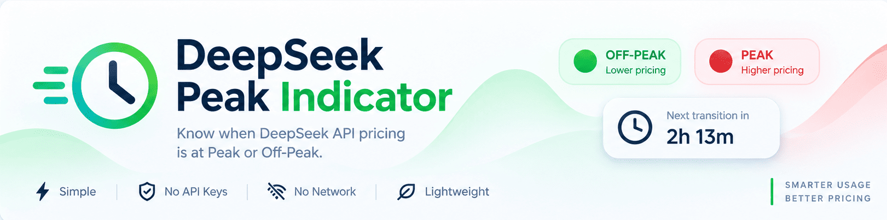

<p align="center">
  
</p>

# DeepSeek Peak Indicator

**English** · [فارسی](README.fa.md) · [简体中文](README.zh-CN.md)


A lightweight DeepSeek Harness plugin that shows the **current DeepSeek API pricing period** —
Peak or Off-Peak — directly in the sidebar footer, from application start, with no Session open.
Click it to see the **countdown to the next pricing transition**.

It needs no API key, makes no network requests and does not poll anything: the schedule is
computed locally from the clock and a bundled, verified Chinese holiday calendar.

> **Peak means the official API pricing period, not server congestion or server health.**
> The indicator reports the billing period defined by DeepSeek; it says nothing about API load,
> latency or availability. Peak prices are the higher **peak** rate; Off-Peak is the half-price rate.

---

## Install

**Requires DeepSeek Harness Desktop v0.2.1-rc.5** — the version this release is built and tested
against. No extra runtime, build step or npm dependency is needed.

```powershell
dsh plugin --profile web add github:jalilahmad/deepseek-peak-indicator
```

Reload the Harness Web GUI (or restart DeepSeek Harness Desktop) after installing. On a harness with
HMR a page refresh is usually enough.

<details>
<summary>Install from the Plugin Manager instead</summary>

1. Open **Plugins** in the Harness sidebar.
2. Choose **Add plugin** → **Install a third-party plugin**.
3. Enter the spec `github:jalilahmad/deepseek-peak-indicator` and install.
4. Make sure the bundle is switched **On**, then reload the page.

</details>

---

## Features

- **One glance, three states** — 🟢 `OFF-PEAK`, 🔴 `PEAK`, ⚪ `UNKNOWN`.
- **Next-transition countdown** — the popover shows the remaining time in whole hours and minutes.
- **Accurate boundaries** — the status flips exactly at the official period boundary; the countdown
  refreshes once a minute and an exact timer handles the transition itself.
- **Always present** — a root-scoped sidebar-footer entry that exists before any Session,
  Conversation or Composer is opened.
- **Holiday-aware** — verified Chinese public-holiday dates for 2025 and 2026; an unverified year is
  reported honestly as **UNKNOWN**, never guessed.
- **Timezone-safe** — the schedule is evaluated in UTC, holiday dates in China Standard Time, and all
  conversions use the browser's IANA `Intl` database (no hardcoded offsets, DST-safe).
- **Tiny and private** — one client bundle, one Host row, one 60-second timer plus one transition
  timer; no API key, backend, database, telemetry or network polling.
- **Clean lifecycle** — timers, listeners, observers and styles are all disposed on unload; reloading
  creates exactly one indicator.

---

## Screenshots

Real captures from DeepSeek Harness Desktop v0.2.1-rc.5 running this plugin. Workspace names and
session titles are blurred for privacy.

**Full application — indicator in the sidebar footer**


**OFF-PEAK with the minimal popover**


**Plugin entry in the Plugin Manager**


The **PEAK** and **UNKNOWN** captures are still pending because those states require real schedule
conditions that did not exist at capture time: PEAK occurs only in the official weekday peak
windows, and UNKNOWN only when the current year's Chinese holiday calendar is not verified. They
will be added after the next real PEAK window; see
[docs/screenshots/SCREENSHOTS_NEEDED.md](docs/screenshots/SCREENSHOTS_NEEDED.md) for the exact
conditions and capture steps.

---

## How it works

The indicator registers in **`sidebar.footer.action`**, the root-scoped list slot beside Settings,
declared by the shipped `@deepseek-ai/dsh-client-ui-sidebar` package. It is part of the permanent
application shell, so it does not depend on a Session, Conversation or Composer. The expanded
sidebar shows a small pill (dot + label); the 56 px rail shows the dot-only compact form.

### States

| State | Meaning |
| --- | --- |
| 🔴 **PEAK** | Inside an official peak window, Monday–Friday, and the date is not a verified Chinese public holiday. Higher API price applies. |
| 🟢 **OFF-PEAK** | Everything else: outside the two daily peak windows, on a weekend, or on a verified Chinese public holiday. Half-price API price applies. |
| ⚪ **UNKNOWN** | Inside a weekday peak window, but the local holiday calendar for that year is not verified (missing, unpublished or malformed). The plugin refuses to guess. |

Weekends are off-peak for the whole day, including weekend makeup workdays (调休), following
DeepSeek's wording that weekends and holidays are off-peak “in full”.

### The minimal popover

Click the indicator; click it again, press `Escape`, or click outside to close it. The popover has
exactly two lines:

```text
🔴 PEAK
Off-Peak starts in: 2h 13m
```

```text
🟢 OFF-PEAK
Peak starts in: 61h 29m
```

```text
⚪ UNKNOWN
Next transition cannot be reliably determined.
```

The countdown is whole hours and minutes only (never seconds). It refreshes once a minute, while an
exact transition timer flips the status at the official boundary. If the end of the current period
would fall into an unverified holiday year, the plugin shows the UNKNOWN line instead of inventing a
countdown.

### Timezone handling

- Peak windows are compared against **UTC** minutes-of-day.
- Chinese holiday dates are looked up against the **`Asia/Shanghai`** calendar date of the instant.
- The China-midnight boundary is derived from that zone with `Intl` (16:00 UTC for `Asia/Shanghai`) —
  computed, never hardcoded.
- The bundle keeps DST-safe, IANA-based helpers with **`Asia/Kabul`** as the default display zone
  (`DISPLAY_TIME_ZONE` in [`client.js`](client.js)); the current minimal popover intentionally shows
  only durations, so timezone handling does not affect what is displayed, only correctness.

---

## Pricing schedule

Per the official DeepSeek pricing documentation:

| Period | When (UTC) | Price |
| --- | --- | --- |
| **Peak** | Monday–Friday, **01:00–04:00** and **06:00–10:00** — excluding Chinese public holidays | Full peak price |
| **Off-Peak** | All other hours, weekends, and Chinese public holidays in full | Half of peak |

Beijing-time equivalents: **09:00–12:00** and **14:00–18:00**. Peak/off-peak pricing was introduced
at **16:00 UTC on 2026-08-16** according to the official change log; always confirm current numbers
on the official pricing page.

Official sources: [DeepSeek pricing](https://api-docs.deepseek.com/quick_start/pricing/) ·
[Chinese pricing page](https://api-docs.deepseek.com/zh-cn/quick_start/pricing) ·
[Change log](https://api-docs.deepseek.com/updates).

---

## Chinese public holidays

Holiday dates live in the editable [`holidays.json`](holidays.json) and are inlined into the browser
bundle by [`tools/sync-holidays.mjs`](tools/sync-holidays.mjs) (a browser bundle cannot read a
sibling file at runtime).

- **2025** and **2026** are verified from the State Council notices
  ([2025](https://www.gov.cn/zhengce/content/202411/content_6986382.htm),
  [2026](https://www.gov.cn/zhengce/zhengceku/202511/content_7047091.htm)).
- A year counts as verified only with `verified: true`, a non-empty official `source`, and
  well-formed, real calendar dates.
- **2027 is deliberately unverified** — the annual arrangement had not been published when this
  release was prepared. 2027 weekday peak windows therefore show **UNKNOWN**; weekends and
  off-peak hours remain certain.
- A year without verified data can never produce a false PEAK.

To add a year: edit `holidays.json`, run `node tools/sync-holidays.mjs`, then run the tests.

---

## Privacy and architecture

- **No API key.** The plugin never asks for, stores or uses one.
- **No backend, no database, no storage.** There is no server component and no account access.
- **No network requests, no polling, no telemetry.** `client.js` contains no `fetch`,
  `XMLHttpRequest`, `WebSocket`, `EventSource` or dynamic `import()`; it reads the local clock and
  the bundled holiday table only.
- **No secrets in the repository.** No keys, tokens, personal paths or machine-specific state.
- **Standard plugin caveat.** Like every DSH plugin, plugin code runs with the Harness application's
  local permissions. Review the source before installing; details and reporting are in
  [SECURITY.md](SECURITY.md).

The plugin is a DSH bundle with an empty Host half and a browser-side Client half:

1. `package.json` declares `dsh.bundle` (the Cordis patch that inserts the Loader row) and
   `dsh.client` (the browser entry).
2. `cordis.patch.yml` inserts the plugin row; [`index.js`](index.js) is a deliberately empty `apply()`.
3. `client.js` registers a lazy module factory, adds the locale dictionaries, and registers the
   indicator in `sidebar.footer.action` through `ctx.slots`.
4. One wall-clock state, one 60-second interval and one exact transition timer drive the UI; all of
   them are cleaned up when the slot entry unloads.

The complete design, status algorithm, transition search and cleanup rules are in
[`docs/architecture.md`](docs/architecture.md).

---

## Compatibility and limitations

- **Tested only on DeepSeek Harness Desktop v0.2.1-rc.5 (Windows).** Other DSH versions, clients and
  platforms are not claimed compatible; `engines.dsh` pins the tested version so untested runtimes
  are refused instead of loaded blindly.
- **Windows collapsed sidebar.** On the Windows titlebar layout the shipped sidebar shell hides its
  entire footer when the sidebar is collapsed (including the shipped Settings control), so the
  indicator is visible in the default expanded sidebar but not in that collapsed state. The
  dot-only compact form is used in the 56 px rail where the shell renders the footer.
- **2027 holiday data.** 2027 weekday peak windows show **UNKNOWN** until the official notice is
  published and the calendar is updated. Weekends and off-hours remain certain.
- **Package name.** The bundle keeps its installed identity `@local/deepseek-peak-indicator`; it is
  distributed from GitHub, not published to npm. The install command uses the repository spec.
- **Screenshots.** Three real captures are shipped; PEAK and UNKNOWN captures require genuine
  schedule conditions and remain pending. See
  [Screenshots](#screenshots) and [SCREENSHOTS_NEEDED.md](docs/screenshots/SCREENSHOTS_NEEDED.md).

---

## Update and uninstall

**Update** — DeepSeek Harness does not update arbitrary GitHub-installed bundles in place:

1. Open **Plugins**, find **DeepSeek Peak Indicator**, and choose **Remove**
   (or `dsh plugin --profile web remove @local/deepseek-peak-indicator`).
2. Reinstall from the same command in [Install](#install).
3. Reload the Web GUI.

**Uninstall** — **Plugins** → **DeepSeek Peak Indicator** → **Remove**, or:

```powershell
dsh plugin --profile web remove @local/deepseek-peak-indicator
```

The plugin stores nothing outside its own bundle, so uninstalling leaves no data behind.

---

## Development

No build step and no dependencies. The only Node.js scripts are the test suite and the holiday sync
tool.

```text
deepseek-peak-indicator/
├── client.js                 # browser half: schedule core, sidebar indicator, popover, timers
├── index.js                  # empty Host half (Loader row)
├── package.json              # bundle manifest, dsh.bundle / dsh.client, metadata
├── cordis.patch.yml          # Loader patch inserting the plugin row
├── holidays.json             # editable Chinese public holiday calendar
├── icon.svg                  # previous plugin icon (retained as backup)
├── locale/                   # plugin display metadata (en, zh)
├── tools/sync-holidays.mjs   # inlines holidays.json into client.js
├── test/schedule.test.mjs    # 22 Node tests (schedule, popover, registration)
├── docs/                     # architecture, marketplace notes, screenshot instructions
├── assets/                   # README banner, runtime plugin icon, marketplace icons
├── screenshots.json          # marketplace storefront screenshot list
├── README.md · README.fa.md · README.zh-CN.md
├── CHANGELOG.md · CONTRIBUTING.md · SECURITY.md · LICENSE
└── .gitignore · .gitattributes
```

`assets/readme-banner.png` is the README hero banner. `assets/icon-512.png` (512×512 PNG, 58.6 KiB,
within DSH's 256 KiB plugin-icon limit) is the **runtime plugin icon**, exported through the existing
`./icon` manifest export; it was verified live in the Plugin Manager. `icon.svg` is retained as the
previous icon/backup, and `assets/icon-180.png` remains a smaller marketplace fallback.

Run the tests:

```powershell
node --test test/schedule.test.mjs
```

Expected result: **22 tests, 22 pass, 0 fail** (verified with Node.js v24.21.0, the runtime bundled
with DSH Desktop v0.2.1-rc.5). The suite covers both peak windows, off-peak hours, weekends and
makeup workdays, holiday overrides, the unpublished-2027 UNKNOWN state, exact transition instants,
countdown formatting, the two-line popover model, the wide/compact forms, the single slot
registration, the Intl-derived China-midnight boundary and malformed-date rejection.

Local development install:

```powershell
git clone https://github.com/jalilahmad/deepseek-peak-indicator.git
dsh plugin --profile web add <absolute-path-to-checkout>
```

Contributions are welcome — see [CONTRIBUTING.md](CONTRIBUTING.md) and [SECURITY.md](SECURITY.md).
Architecture notes: [`docs/architecture.md`](docs/architecture.md); marketplace/submission notes:
[`docs/marketplaces.md`](docs/marketplaces.md).

---

## License, author and credits

[MIT](LICENSE) © 2026 **Jalil Ahmad Fazeli** · [@jalilahmad](https://github.com/jalilahmad) ·
[repository](https://github.com/jalilahmad/deepseek-peak-indicator) ·
[issues](https://github.com/jalilahmad/deepseek-peak-indicator/issues)

This is an independent community plugin, not affiliated with DeepSeek.

Credits and official sources:

- The plugin follows the official DeepSeek Harness bundle/Cordis plugin model
  (`dsh.bundle` patch + `dsh.client` browser half + `ctx.slots` registration).
- Pricing rules: [DeepSeek API pricing](https://api-docs.deepseek.com/quick_start/pricing/) and
  [Chinese version](https://api-docs.deepseek.com/zh-cn/quick_start/pricing);
  introduction date: [change log](https://api-docs.deepseek.com/updates).
- Chinese public holiday arrangements: 2025 and 2026 State Council notices (linked above).
- `Intl`/IANA timezone data comes from the browser runtime; `react` and `react-dom` are provided by
  the Harness browser module table. No third-party source code is vendored.
- Icon and README banner artwork are original assets created for this plugin.
